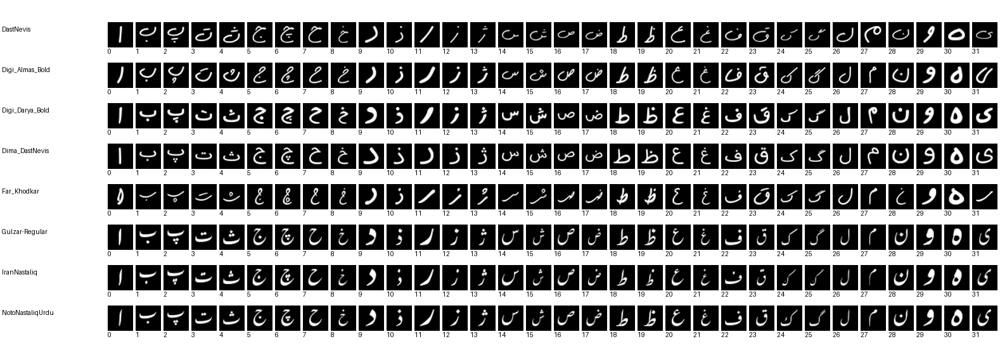
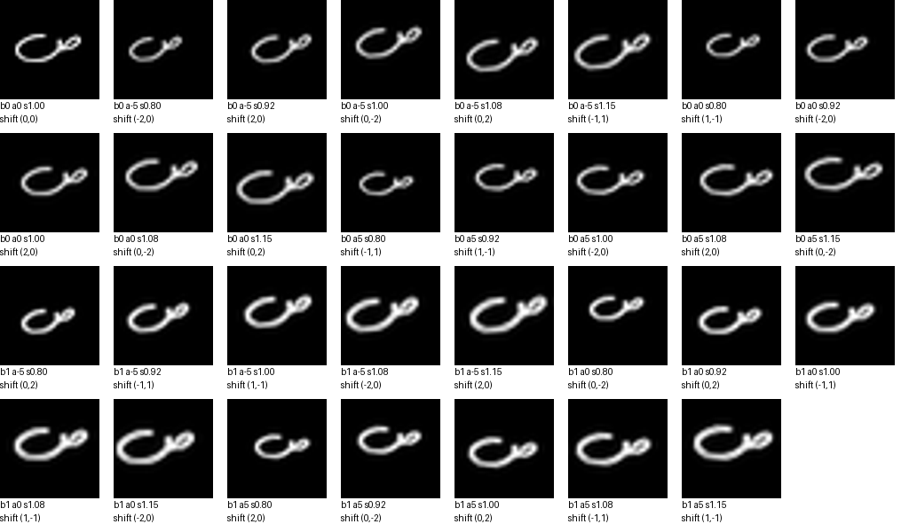

<div dir="rtl" align="right">

# ✍️ تشخیص حروف دست‌نویس فارسی با یادگیری ماشین

### از ساخت دیتاست تا مقایسه مدل‌ها و آزمایش یک حرف جدید

[مشاهده نوت‌بوک و خروجی‌ها](persian-letter-recognition.ipynb) · [باز کردن در Colab](https://colab.research.google.com/github/KianaAbbasabadi/persian-handwritten-letter-recognition/blob/master/persian-letter-recognition.ipynb)

**۷۹۳۶ تصویر · ۳۲ کلاس · ۸ فونت · دقت تست مدل منتخب: ۸۲٫۸۱٪**

این پروژه یک مسیر کامل برای طبقه‌بندی **۳۲ حرف مستقل فارسی** ارائه می‌کند: ساخت تصاویر با فونت‌های دارای ظاهر دست‌نویس و خوشنویسی، افزایش تنوع داده‌ها، آماده‌سازی تصاویر، تنظیم ابرپارامترها و مقایسه سه مدل **SVM، KNN و Random Forest**.

در پایان نیز می‌توان تصویر یک حرف نوشته‌شده روی کاغذ را وارد کرد و پیش‌بینی مدل منتخب را دید.

> **درباره داده‌ها:** دیتاست این پروژه مصنوعی و تولیدشده با فونت است؛ اسکن دست‌خط افراد نیست. بنابراین، Accuracy روی فونت‌های ندیده را نباید معادل دقت روی دست‌خط واقعی انسان در نظر گرفت.

---

## 🎯 هدف پروژه

آیا می‌توان با داده‌های فونتی و الگوریتم‌های کلاسیک یادگیری ماشین، شکل یک حرف فارسی را تشخیص داد و به فونتی که در آموزش حضور نداشته تعمیم داد؟

برای بررسی این سؤال، پروژه علاوه بر آموزش مدل‌ها، روی **کیفیت داده، جلوگیری از نشت اطلاعات و ارزیابی روی فونت‌های جدید** تمرکز دارد.

دامنه مسئله، تشخیص **یک حرف جداگانه در هر تصویر** است. خواندن کلمه، جمله، صفحه و جداسازی خودکار حروف از متن در این نسخه پیاده‌سازی نشده است.

## ✨ امکانات

- تولید تکرارپذیر تصاویر با برچسب ثابت برای هر حرف
- استفاده از ۸ فونت و بررسی پوشش هر ۳۲ حرف فارسی
- تولید حالت‌های متنوع با تغییر ضخامت، زاویه، مقیاس و موقعیت
- ثبت مشخصات هر تصویر در فایل متادیتا
- آماده‌سازی ورودی‌های ثابت ۳۲×۳۲ و استخراج ویژگی‌های پیکسلی
- استانداردسازی داخل Pipeline برای مدل‌های SVM و KNN
- جست‌وجوی پارامترها با GridSearchCV و اعتبارسنجی گروهی
- انتخاب پارامتر و مدل بر اساس **Accuracy اعتبارسنجی**
- گزارش Accuracy، Error، Macro-F1 و ماتریس اغتشاش
- آزمایش عکس یک حرف و نمایش مراحل پاک‌سازی آن
- ذخیره مدل منتخب، تنظیمات و نتایج جست‌وجو

## 🖼️ نگاهی به دیتاست

### تمام حروف در فونت‌های مختلف



ترتیب خانه‌ها در این تصویر از چپ به راست و مطابق شماره کلاس‌هاست.

### تغییرات روی یک حرف



این نمونه‌ها شکل‌های تغییریافته یک حرف در یک فونت هستند؛ هر نمونه افزوده‌شده، نویسنده یا سبک مستقل جدیدی محسوب نمی‌شود.

## 📊 مشخصات داده‌ها

| ویژگی | مقدار |
|---|---|
| تعداد کلاس‌ها | ۳۲ حرف مستقل فارسی |
| تعداد فونت‌ها | ۸ |
| تصاویر هر حرف در هر فونت | ۳۱ |
| تصاویر هر فونت | ۹۹۲ |
| کل تصاویر | **۷۹۳۶** |
| ابعاد ورودی مدل | ۳۲×۳۲ پیکسل |
| نمایش تصویر | تک‌کاناله خاکستری؛ حرف روشن روی زمینه تیره |
| تعداد ویژگی‌های هر نمونه | ۱۰۲۴ مقدار پیکسلی |
| بازه مقادیر ورودی قبل از استانداردسازی | صفر تا یک |

### فونت‌های استفاده‌شده

| فونت | نقش در مجموعه |
|---|---|
| DastNevis | سبک دست‌نویس |
| Far Khodkar | سبک خودکار |
| Dima DastNevis | سبک دست‌نویس |
| Digi Darya Bold | سبک دست‌نویس ضخیم |
| Digi Almas Bold | سبک دست‌نویس ضخیم |
| IranNastaliq | سبک خوشنویسی نستعلیق فارسی |
| Gulzar | سبک نستعلیق با ریشه اردو؛ سبک کمکی |
| Noto Nastaliq Urdu | سبک نستعلیق با ریشه اردو؛ سبک کمکی |

پوشش حروف فارسی برای هر فونت بررسی می‌شود. پوشش Unicode به‌تنهایی به معنی یکسان‌بودن شکل نوشتاری آن با دست‌خط روزمره فارسی نیست؛ پیش‌نمایش‌ها برای بررسی شکل حروف ارائه شده‌اند.

### کلاس‌ها

**ا، ب، پ، ت، ث، ج، چ، ح، خ، د، ذ، ر، ز، ژ، س، ش، ص، ض، ط، ظ، ع، غ، ف، ق، ک، گ، ل، م، ن، و، ه، ی**

نگاشت برچسب به حرف در `classes.json` ذخیره شده و در تمام فونت‌ها ثابت است. این نسخه کلاس جداگانه‌ای برای «آ» ندارد.

## 🔄 افزایش داده‌ها

برای رسم اولیه، یک اندازه پایه فونت برابر با ۴۸ انتخاب شده است. حرف و نقطه‌هایش ابتدا با حفظ نسبت ابعاد در قاب قرار می‌گیرند و سپس تغییرات اعمال می‌شوند.

| تغییر | تنظیم |
|---|---|
| ضخامت | حالت اصلی و بولد مصنوعی ملایم |
| چرخش | ۵-، صفر و ۵+ درجه |
| مقیاس | ۰٫۸، ۱۱÷۱۲، ۱، ۱۳÷۱۲ و ۱٫۱۵ |
| جابه‌جایی | افقی، عمودی و مورب، تا ۲ پیکسل |
| ابعاد نهایی | همواره ۳۲×۳۲ |

برای هر حرف/فونت، **۳۰ ترکیب از ضخامت، زاویه و Scale** ساخته می‌شود و Shiftها به‌صورت چرخشی به این ترکیب‌ها اختصاص می‌یابند. یک تصویر اصلی نیز نگه داشته می‌شود؛ در نتیجه مجموعاً ۳۱ نمونه داریم. همه ترکیب‌های ممکن Shift با سایر پارامترها ساخته نمی‌شوند.

نسبت‌های ۱۱÷۱۲ و ۱۳÷۱۲ اثر کوچک و بزرگ‌شدن شکل حرف را شبیه‌سازی می‌کنند؛ به معنی رسم مستقیم فونت در اندازه ۱۱ یا ۱۳ پیکسل نیستند.

**پس از اعمال تغییرات، تصاویر دوباره Crop و مرکزگذاری نمی‌شوند** تا اثر جابه‌جایی و تغییر مقیاس حفظ شود. جزئیات هر تصویر، از جمله فونت، برچسب، زاویه، Scale، Shift و اصل یا افزوده‌بودن، در `metadata.csv` ثبت شده است.

## 🧹 آماده‌سازی تصاویر

### داده‌های مصنوعی

تصاویر تولیدشده از قبل آماده و هم‌اندازه‌اند. هنگام آموزش مستقیماً خوانده می‌شوند، مقادیر پیکسل بر ۲۵۵ تقسیم می‌شود و هر تصویر به یک بردار ۱۰۲۴تایی تبدیل می‌شود.

### عکس ورودی کاربر

برای عکس یک حرف تیره روی کاغذ روشن، مراحل زیر اجرا می‌شود:

۱. اصلاح جهت عکس و تبدیل به خاکستری
۲. تخمین روشنایی زمینه و کاهش اثر سایه
۳. آستانه‌گذاری برای جداکردن نوشته از کاغذ
۴. حذف بخشی از نویزهای کوچک با تلاش برای حفظ نقطه‌های نزدیک بدنه
۵. جداکردن محدوده حرف و قرار دادن آن در قاب ۳۲×۳۲
۶. استخراج ویژگی و پیش‌بینی با Pipeline منتخب

پاک‌سازی عکس با فرض وجود یک حرف و زمینه نسبتاً ساده انجام می‌شود. نقطه‌های خیلی ریز، لکه، خط دفتر و سایه شدید ممکن است نتیجه را خراب کنند؛ به همین دلیل تصویر آماده‌شده نیز نمایش داده می‌شود.

## 🧪 تقسیم آموزش، اعتبارسنجی و تست

تقسیم ساده تصادفی تصاویر می‌تواند نسخه اصلی یک حرف را در یک بخش و نسخه چرخیده همان فونت را در بخش دیگر قرار دهد. برای جلوگیری از این هم‌پوشانی، جداسازی این پروژه **بر اساس فونت** انجام می‌شود.

### تست نهایی

با `random_state=42`، دو فونت از هشت فونت کنار گذاشته می‌شوند. در اجرای ثبت‌شده:

- **فونت‌های تست:** `Digi_Almas_Bold` و `Gulzar-Regular`
- **فونت‌های آموزش:** `DastNevis`، `Digi_Darya_Bold`، `Dima_DastNevis`، `Far_Khodkar`، `IranNastaliq` و `NotoNastaliqUrdu`

| بخش | تعداد فونت | نمونه‌های استفاده‌شده | تعداد تصاویر |
|---|---:|---|---:|
| آموزش | ۶ | اصل و نسخه‌های افزوده‌شده | ۵۹۵۲ |
| تست نهایی | ۲ | فقط تصاویر اصلی | ۶۴ |
| خارج از ارزیابی | همان ۲ فونت تست | نسخه‌های افزوده‌شده | ۱۹۲۰ |

هیچ نمونه‌ای از فونت‌های تست وارد آموزش یا تنظیم پارامترها نمی‌شود. نسخه‌های افزوده‌شده فونت تست در پوشه داده باقی می‌مانند، اما در این ارزیابی استفاده نمی‌شوند.

### اعتبارسنجی

داخل شش فونت آموزش، از **GroupKFold با چهار بخش** استفاده می‌شود:

- در هر Fold، فونت‌های Fit و Validation جدا هستند.
- آموزش با اصل و نسخه‌های افزوده‌شده فونت‌های Fit انجام می‌شود.
- اعتبارسنجی فقط روی تصاویر اصلی فونت‌های Validation انجام می‌شود.
- نسخه‌های افزوده‌شده فونت‌های Validation وارد Fit همان Fold نمی‌شوند.
- استانداردسازی داخل Pipeline و فقط با داده Fit همان Fold برازش می‌شود.

بهترین تنظیمات هر مدل با میانگین Accuracy اعتبارسنجی انتخاب می‌شود. سپس مدل‌ها روی تمام داده آموزش برازش می‌شوند. **مدل منتخب پیش از مشاهده نتیجه تست مشخص می‌شود.**

این پروتکل تعمیم به فونت جدید را می‌سنجد. با وجود ۶۴ تصویر تست، نتیجه به فونت‌های کنارگذاشته‌شده حساس است؛ برای به‌دست‌آوردن عدد بهتر نباید Seed یا فونت‌های تست را پس از دیدن نتیجه تغییر داد.

## 🤖 مدل‌ها و ابرپارامترها

### SVM

Pipeline شامل `StandardScaler` و `SVC` با کرنل RBF است.

| پارامتر | مقادیر |
|---|---|
| `C` | `0.01, 0.1, 0.5, 1, 5, 10, 50, 100` |
| `gamma` | `scale, 0.0001, 0.001, 0.01` |
| `kernel` | `rbf` |

**۳۲ ترکیب و ۱۲۸ برازش اعتبارسنجی**، به‌علاوه برازش نهایی بهترین ترکیب.

### KNN

Pipeline شامل `StandardScaler` و `KNeighborsClassifier` است.

| پارامتر | مقادیر |
|---|---|
| `n_neighbors` | `1, 3, 5, 10, 20, 50, 100` |
| `weights` | `uniform, distance` |
| `p` | `1, 2` |

**۲۸ ترکیب و ۱۱۲ برازش اعتبارسنجی**، به‌علاوه برازش نهایی بهترین ترکیب. مقادیر `p` به‌ترتیب فاصله منهتن و اقلیدسی را مشخص می‌کنند.

### Random Forest

این مدل به استانداردسازی پیکسل‌ها نیاز ندارد و Pipeline آن شامل خود مدل است.

| پارامتر | مقادیر |
|---|---|
| `n_estimators` | `100, 200, 500` |
| `max_depth` | `None, 10, 20, 50` |
| `min_samples_split` | `2, 5, 10` |
| `min_samples_leaf` | `1, 2` |

**۷۲ ترکیب و ۲۸۸ برازش اعتبارسنجی**، به‌علاوه برازش نهایی بهترین ترکیب.

پارامترهای `max_depth` و `min_samples_split` در این پروژه برای Random Forest تنظیم می‌شوند؛ KNN این پارامترها را ندارد.

## 📈 معیارهای ارزیابی و نتایج

| معیار | کاربرد |
|---|---|
| **Accuracy اعتبارسنجی** | معیار اصلی انتخاب پارامترها و مدل |
| **Accuracy تست** | سهم پاسخ‌های درست روی فونت‌های کنارگذاشته‌شده |
| Error | یک منهای Accuracy |
| Macro-F1 | میانگین F1 کلاس‌ها با وزن برابر؛ معیار تکمیلی |
| ماتریس اغتشاش | مشاهده الگوی اشتباه بین حروف |
| Precision و Recall هر کلاس | بررسی جزئی‌تر عملکرد برای هر حرف |

در گزارش GridSearchCV، ستون `mean_test_score` به امتیاز **اعتبارسنجی** اشاره دارد؛ تست نهایی پروژه نیست.

### نتایج اجرای ثبت‌شده

نتایج زیر مستقیماً از خروجی [نوت‌بوک اجراشده در گیت‌هاب](https://github.com/KianaAbbasabadi/persian-handwritten-letter-recognition/blob/master/persian-letter-recognition.ipynb) استخراج شده‌اند. شناسه فایل Git هنگام بررسی: `df5e0c23ac4b4f0f8c4ea0c3bd65f4c12484c1de`.

| مدل | Accuracy اعتبارسنجی | Accuracy تست | خطای تست | Macro-F1 تست | پاسخ درست |
|---|---:|---:|---:|---:|---:|
| **SVM — مدل منتخب** | **۷۱٫۴۸٪** | **۸۲٫۸۱٪** | ۱۷٫۱۹٪ | ۰٫۸۱۲۵ | ۵۳ از ۶۴ |
| KNN | ۵۷٫۰۳٪ | ۶۵٫۶۳٪ | ۳۴٫۳۸٪ | ۰٫۶۱۶۸ | ۴۲ از ۶۴ |
| Random Forest | ۷۰٫۷۰٪ | **۸۲٫۸۱٪** | ۱۷٫۱۹٪ | ۰٫۸۲۱۹ | ۵۳ از ۶۴ |

درصدها برای نمایش گرد شده‌اند. Accuracy اعتبارسنجی، میانگین بدون وزن امتیاز چهار Fold است؛ تعداد تصاویر Validation در Foldها به‌ترتیب ۶۴، ۶۴، ۳۲ و ۳۲ است.

### بهترین پارامترهای انتخاب‌شده

| مدل | پارامترهای منتخب GridSearchCV |
|---|---|
| SVM | `C=5`, `gamma='scale'`, `kernel='rbf'` |
| KNN | `n_neighbors=5`, `p=2`, `weights='uniform'` |
| Random Forest | `n_estimators=500`, `max_depth=None`, `min_samples_split=2`, `min_samples_leaf=2` |

برخی تنظیمات در جست‌وجو امتیاز برابر داشته‌اند؛ جدول بالا همان ترکیبی را نشان می‌دهد که در `best_params_` ثبت شده است.

### تفسیر نتایج

- **SVM پیش از مشاهده تست انتخاب شده است**، چون میانگین Accuracy اعتبارسنجی آن از دو مدل دیگر بیشتر بوده است.
- SVM و Random Forest هر دو ۵۳ پاسخ درست روی تست دارند؛ در این مجموعه کوچک، برتری Accuracy تست بین آن‌ها دیده نمی‌شود. Macro-F1 جنگل تصادفی کمی بالاتر است، اما معیار انتخاب از ابتدا Accuracy اعتبارسنجی بوده است.
- اختلاف Accuracy اعتبارسنجی SVM و Random Forest حدود ۰٫۷۸ واحد درصد است؛ این اختلاف به‌تنهایی اثبات برتری پایدار یا معنادار آماری SVM نیست.
- در گزارش SVM، حرف «ی» در هر دو نمونه تست اشتباه تشخیص داده شده و Recall آن صفر است؛ بنابراین دقت کلی، ضعف برخی حروف را پنهان می‌کند.
- Accuracy تست مدل منتخب دقیقاً `53/64 = 0.828125` است. هر پاسخ در این تست حدود ۱٫۵۶ واحد درصد Accuracy را تغییر می‌دهد.

خروجی ذخیره‌شده نوت‌بوک، اجرای سلول ذخیره نتایج را تأیید می‌کند. این سلول فایل‌های زیر را در محیط اجرا تولید می‌کند؛ پوشه `results/` در زمان بررسی هنوز در مخزن منتشر نشده بود:

| فایل | محتوا |
|---|---|
| `results/validation_results.csv` | بهترین پارامترها و Accuracy اعتبارسنجی هر مدل |
| `results/test_results.csv` | Accuracy، Error، Macro-F1 و تعداد پاسخ درست روی تست |
| `results/SVM_grid.csv` | نتایج تمام تنظیمات SVM |
| `results/KNN_grid.csv` | نتایج تمام تنظیمات KNN |
| `results/Random_Forest_grid.csv` | نتایج تمام تنظیمات Random Forest |
| `results/model.joblib` | Pipeline مدل منتخب |
| `results/settings.json` | تنظیمات اجرا، فونت‌ها، کلاس‌ها و اطلاعات تولید داده |
| `results/data_split.csv` | عضویت هر تصویر در آموزش، تست یا داده استفاده‌نشده |

## 🚀 اجرای پروژه

### Google Colab

۱. نوت‌بوک را با [این لینک در Colab باز کنید](https://colab.research.google.com/github/KianaAbbasabadi/persian-handwritten-letter-recognition/blob/master/persian-letter-recognition.ipynb).

۲. **سلول اول آپلود ZIP را اجرا نکنید.** آن سلول مخصوص بسته اولیه است. برای نسخه گیت‌هاب، آن را با سلول زیر جایگزین و اجرا کنید:

</div>

```python
from pathlib import Path
import subprocess
import os

project_dir = Path('/content/persian-handwritten-letter-recognition')
if not project_dir.exists():
    subprocess.run([
        'git', 'clone',
        'https://github.com/KianaAbbasabadi/persian-handwritten-letter-recognition.git',
        str(project_dir)
    ], check=True)

os.chdir(project_dir)
# Existing notebook checks this directory even when using the ready-made data.
# Font files are needed only when regenerating the dataset.
(project_dir / 'fonts').mkdir(exist_ok=True)
print('Project directory:', Path.cwd())
```

<div dir="rtl" align="right">

۳. وجود `dataset_augmented/metadata.csv` را بررسی کنید. داده‌ها همراه مخزن دریافت می‌شوند و نیازی به آپلود جداگانه تصاویر نیست.

۴. سلول نصب کتابخانه‌ها و سپس سایر سلول‌ها را به‌ترتیب اجرا کنید.

۵. برای استفاده از تصاویر آماده، `REGENERATE=False` باقی بماند.

۶. بعد از پایان آموزش و ارزیابی، بخش آپلود عکس را اجرا و یک تصویر تک‌حرفی انتخاب کنید.

**نکته زمان اجرا:** جست‌وجوی کامل شامل ۵۲۸ برازش اعتبارسنجی و سه برازش نهایی است. این پیاده‌سازی مدل‌های Scikit-learn از CPU استفاده می‌کند و انتخاب GPU آن را به آموزش GPU تبدیل نمی‌کند. زمان اجرا به منابع محیط و پارامترها بستگی دارد.

### اجرای محلی نوت‌بوک

کتابخانه‌ها را با دستور زیر نصب کنید:

</div>

```bash
python -m pip install -r requirements.txt
```

<div dir="rtl" align="right">

نوت‌بوک را از پوشه اصلی پروژه باز کنید و مرحله آپلود مخصوص Colab را رد کنید. اگر `fonts/` موجود نیست، یک پوشه خالی با همین نام بسازید تا بررسی اولیه مسیر در نسخه فعلی نوت‌بوک عبور کند؛ برای استفاده از داده آماده، `REGENERATE=False` بماند. بخش بارگذاری عکس با `google.colab.files` مخصوص Colab است؛ برای آزمایش محلی، به‌جای اجرای آن سلول، مسیر عکس را در متغیر `photo_path` قرار دهید.

### تولید دوباره داده‌ها

فایل فونت‌ها در مخزن فعلی منتشر نشده‌اند. برای تولید دوباره تصاویر، ابتدا فونت‌ها را از منابع معرفی‌شده تهیه و در `fonts/` قرار دهید. سپس اجرا کنید:

</div>

```bash
python generate_dataset.py
```

<div dir="rtl" align="right">

یا در نوت‌بوک، `REGENERATE=True` را قرار دهید. پوشه خروجی شناخته‌شده `dataset_augmented` بازسازی می‌شود؛ فایل شخصی داخل این پوشه قرار ندهید.

پس از افزودن فونت، تعداد تصاویر و عضویت فونت‌ها در Split ممکن است تغییر کند. اعداد این README مربوط به نسخه هشت‌فونتی هستند.

## 📁 فایل‌های اصلی

| مسیر | توضیح |
|---|---|
| `persian-letter-recognition.ipynb` | مراحل آموزش، اعتبارسنجی، ارزیابی و آزمایش عکس |
| `generate_dataset.py` | تولید دیتاست و بررسی فونت‌ها |
| `dataset_augmented/images/` | تصاویر آماده، به تفکیک فونت و حرف |
| `dataset_augmented/metadata.csv` | مشخصات و برچسب هر تصویر |
| `dataset_augmented/classes.json` | نگاشت برچسب‌ها به حروف |
| `dataset_augmented/generation_report.json` | گزارش تولید و مشخصات فونت‌ها |
| `dataset_augmented/font_preview.png` | پیش‌نمایش حروف همه فونت‌ها |
| `dataset_augmented/augmentation_preview.png` | پیش‌نمایش افزایش داده |
| `requirements.txt` | وابستگی‌های پروژه |
| `SOURCES.md` | منابع فونت‌ها و روش‌ها |
| `results/` | خروجی تولیدشده هنگام اجرا؛ هنوز در مخزن فعلی منتشر نشده |

## ⚠️ محدودیت‌ها

- داده فونتی جایگزین کامل نمونه‌های دست‌خط واقعی نیست.
- زیادشدن تصاویر با Augmentation به معنی زیادشدن تعداد نویسندگان مستقل نیست.
- فونت‌های خوشنویسی ممکن است با نوشتن معمولی افراد تفاوت زیادی داشته باشند.
- شباهت سبک بعضی فونت‌ها می‌تواند انتقال بین آن‌ها را آسان‌تر کند.
- تست نهایی کوچک است و نتیجه به فونت‌های انتخاب‌شده حساس است.
- مدل برای یک ورودی قابل پردازش، یکی از ۳۲ کلاس را انتخاب می‌کند؛ سامانه مستقلی برای رد تصویر نامرتبط ندارد.
- پیش‌پردازش عکس ممکن است نقطه‌ها را حذف یا شکل بدنه را تغییر دهد.
- بیشترکردن داده مصنوعی و گسترده‌ترکردن جست‌وجوی پارامترها، بهبود Accuracy را تضمین نمی‌کند.

## 🛠️ مسیر توسعه

- جمع‌آوری داده واقعی از چند نویسنده و جداسازی نویسنده‌های آموزش و تست
- ارزیابی روی مجموعه برچسب‌دار مستقلی از عکس‌های واقعی
- مقایسه ویژگی‌های پیکسلی با HOG
- بررسی CNN در یک آزمایش جداگانه با پروتکل ارزیابی یکسان
- تحلیل دقیق‌تر حروف مشابه و خطاهای مربوط به نقطه‌ها
- افزودن سازوکاری برای تشخیص ورودی نامعتبر یا نامطمئن

موارد بالا پیشنهاد توسعه‌اند و جزو قابلیت‌های پیاده‌سازی‌شده این نسخه محسوب نمی‌شوند.

## 📚 منابع و حقوق استفاده

منابع دریافت فونت‌ها و مستندات روش‌ها در [SOURCES.md](SOURCES.md) آمده‌اند. مجوز هر فونت مستقل از کد پروژه است؛ وجود فایل در یک مخزن یا امکان دانلود آن به‌تنهایی مجوز بازنشر آن محسوب نمی‌شود. برای تولید دوباره داده‌ها، فونت‌ها را مطابق شرایط صاحب اثر تهیه کنید.

- [Scikit-learn](https://scikit-learn.org/stable/)
- [Pillow](https://pillow.readthedocs.io/)
- [OpenCV](https://docs.opencv.org/)

---

**تهیه‌کننده: Kiana Abbas Abadi**  
پروژه آموزشی یادگیری ماشین — تشخیص حروف مستقل فارسی

</div>
